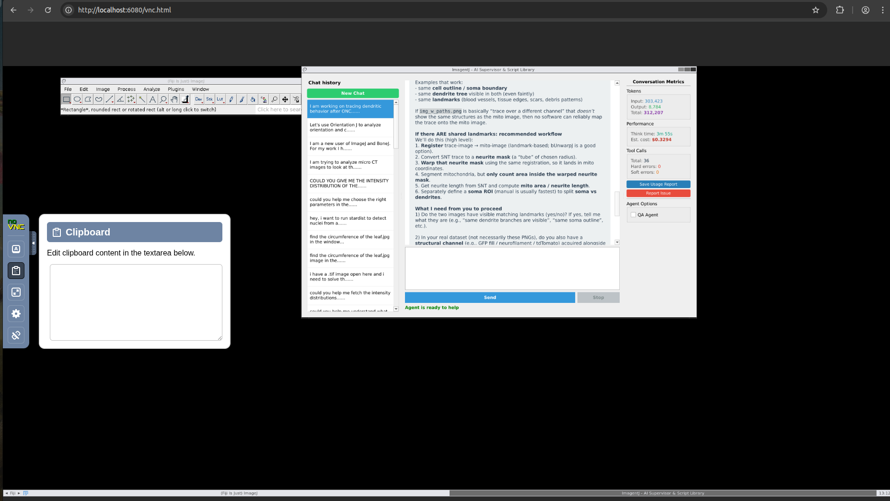

# The Interface and How Agentic-J Works

## What you see in the browser

When you open `http://localhost:6080/vnc.html`, you see a virtual desktop in your browser with:

- the **Agentic-J chat window**: your conversations, a **New Chat** button and a cost meter;
- **Fiji**, the full program, which you can use by hand as usual;
- **napari** windows, which open when the assistant (or you) uses napari.

The desktop is scaled to fit your browser window.

### Buttons and options in the chat window

| Control | What it does |
|---------|-------------|
| **Send / Enter** | Sends your message. |
| **Sending while it works** | You can type and send a message while the assistant is busy. It is added as a note, and the assistant reads it at its next step. Use this to correct course ("use channel 2, not 1") without stopping anything. If a long script is running, the note waits until that script finishes. |
| **Stop** | Asks the assistant to stop after the step it is doing now. It doesn't cut off a step halfway. Use it if the assistant is going the wrong way or taking too long. |
| **Attach files** | Drag files or folders onto the chat window. Only their location (path) is shared with the assistant, not their contents. |
| **Vision Judge** (tick box) | Lets an image-reading AI model look at your images and results and comment on them. **Off by default.** It costs extra and sends small copies of your images to the AI provider; see [What happens when the Vision Judge is on](05_security.md#the-vision-judge). The setting is saved per chat and can't be changed while the assistant is working. |
| **QA Agent** (tick box) | At the end of an analysis, a checker reviews the project folder and writes `QA_Checklist_Report.md`. **Off by default**, and it adds a little cost. Set it before your first message. |
| **Save Usage Report** | Saves a file with the number of AI tokens used and the estimated cost of this chat. |
| **Report Issue** | Shows the GitHub issues link and the support email address, each with a Copy button (see [Reporting issues](04_data_history_and_reports.md#reporting-issues)). |

### Long-running steps

Some steps, such as segmenting a whole folder of images or training a model, take many minutes. When a step is still running after a short while, Agentic-J lets it continue in the background and frees up the chat. You can keep asking questions in the meantime. When the step finishes, a message starting with `[DETACHED RUN FINISHED]` appears and the assistant carries on with the result.

---

## Copying and pasting (clipboard)

Your computer's clipboard and the virtual desktop are separate. To move text between them, use the clipboard tool in the noVNC side bar on the left edge of the browser window.



To paste text into Fiji (for example a file path):
1. Click the clipboard icon in the side bar.
2. Paste your text into the clipboard box.
3. Click inside the Fiji window and paste as usual (Ctrl+V / Cmd+V).

To copy text out, select it on the virtual desktop, then open the clipboard box and copy it from there.

---

## Three modes

Agentic-J works in one of three modes. It starts in **Advanced** and switches when your request changes. You can also ask for a mode directly, for example "just make a maximum projection of this stack, nothing else" or "teach me about thresholding".

| Mode | When it is used | What happens |
|------|-----------------|--------------|
| **Advanced** | A real analysis project | It asks questions, proposes a plan, writes and tests scripts, runs statistics and plots, and documents everything in a project folder. |
| **Quick** | A single operation | It does one thing quickly (for example, crop, convert, split channels) without planning and project set-up. |
| **Education** | Learning | It works as a tutor using a built-in bioimage analysis course. See [Learning mode](07_learning_mode.md). |

---

## How a request is handled

You only talk to one assistant (the *supervisor*). Behind the scenes it hands parts of the work to specialised helpers and checks their results. You never need to address them yourself.

| Helper | What it does |
|--------|------|
| **Supervisor** | Talks with you, plans the analysis, keeps track of the project and decides which helper does what. |
| **Plugin finder** | Picks the best Fiji plugin or tool for the task, checks whether it is installed and installs it if needed (asking you first). |
| **Fiji script writer** | Writes the Fiji scripts (Groovy) that do the image processing. |
| **Script fixer** | When a script fails, reads the error and repairs the script. |
| **Data analyst** | Runs Python for measurements, statistics and plots, and also runs napari, micro-sam and Cellpose. |
| **Vision Judge** (optional) | Looks at images and results and says whether they look right. See [Security and privacy](05_security.md#the-vision-judge). |
| **QA checker** (optional) | Reviews the finished project folder against good-practice and publishing standards. |

In Advanced mode, a typical analysis goes: understand what you need → pick the tool → agree on a plan with you → set up the project folder → write and test scripts → measure and run statistics → make plots → summarise and document → (optional) quality check.

The assistant stops to ask you at important points: approving the plan, confirming channel names when the image information is missing or unclear, checking segmentation results on example images, correcting a model's mistakes when [fine-tuning](06_napari_and_fine_tuning.md), and before installing new plugins.

### It learns from fixed errors

When a script fails and gets fixed, Agentic-J writes down the lesson (what went wrong and how it was fixed) and reuses working scripts later. These notes are kept in `data/learned/`, so the same mistake is less likely to happen again. This happens automatically.

---

## Help with a Fiji or napari window

If a Fiji plugin window (or napari) is open and you are unsure what a setting means, ask in the chat:

> "What does this window do?"

or

> "Help me fill in the settings in this window."

Agentic-J takes a screenshot of the window, explains each setting and suggests values for your task. Make sure the window is fully visible and not hidden behind another window. The screenshot is sent to the AI provider; see [Security and privacy](05_security.md).

---

## Plugins Agentic-J knows well

Agentic-J comes with detailed instructions for these tools, so it uses them more reliably:

3D ImageJ Suite · BigStitcher · Bio-Formats · BioVoxxel Toolbox · BoneJ · bUnwarpJ · Cellpose · CLIJ2 · Coloc 2 · CSBDeep · DeepImageJ · FeatureJ · ilastik · Labkit · MIST · MorphoLibJ · NeuronJ · OrientationJ · Sholl Analysis · SNT · StackReg · StarDist · TrackMate (including the StarDist and Cellpose detectors) · TransformJ · TurboReg · **napari** and **micro-sam** (see [chapter 06](06_napari_and_fine_tuning.md))

The Fiji `Plugins` menu may be too long to show everything. To find a plugin, use the Fiji search bar or `Plugins > Utilities > Find Commands...`.

You can ask the assistant to install other plugins, or install them yourself through `Help > Update...` in Fiji. **Be careful with installing by hand**: plugins can clash with each other and break things that worked before. Plugins without built-in instructions are also used less reliably.

If something breaks after installing a plugin, you can reset Fiji's plugins to the original state:
```bash
docker compose down
docker volume rm imagent_j_fiji_plugins imagent_j_fiji_jars
docker compose up
```

---

## Deep-learning tools: tips

### StarDist (nuclei and round cells)
Use the StarDist plugin (`Plugins > StarDist > StarDist 2D`) rather than running StarDist models through DeepImageJ. StarDist is also available as a detector in TrackMate (`Plugins > Tracking > TrackMate`).

### Cellpose (cells of many shapes)
In Fiji, use Cellpose through TrackMate (`Plugins > Tracking > TrackMate`, then choose the Cellpose detector) and select `cellpose` as the environment in the drop-down list.

**Cellpose-SAM** (the newer Cellpose 4 model, environment `cellpose4`) is very slow without a graphics card: expect several minutes per image. Use it only when simpler methods are not good enough.

### Your own Cellpose models
If you have trained a Cellpose model yourself, put the model file in `data/fine-tuned-models/` and tell the assistant its name. Details are in [`data/fine-tuned-models/README.md`](../data/fine-tuned-models/README.md). Models that Agentic-J [fine-tunes for you](06_napari_and_fine_tuning.md) are saved in your project folder and used automatically.

---

## Settings (`imagentj_config.yaml`)

`imagentj_config.yaml` in the project folder lets you change, without rebuilding anything:

- **which AI model** each helper uses (for example a cheaper model for the data analyst);
- **how much the models "think"** before answering (more thinking is slower and costs more, but can be more careful);
- whether the Vision Judge and QA checker run in **unattended (automatic) runs**. In the normal chat window, the tick boxes decide.

Changes take effect the next time you start Agentic-J. Deleting a line restores its default. With only an OpenAI key, only OpenAI models can be used; with an OpenRouter key, models from other companies can be chosen too.

### Adding other tools (advanced)

napari is connected to Agentic-J through the Model Context Protocol (MCP), a standard way of plugging tools into AI assistants. Other MCP tools can be added in `.imagentj/mcp.json` without rebuilding.
